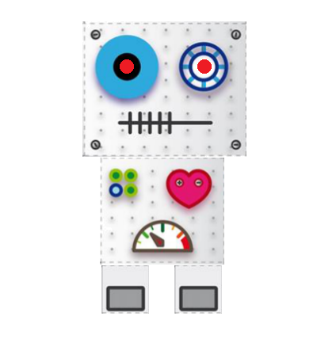
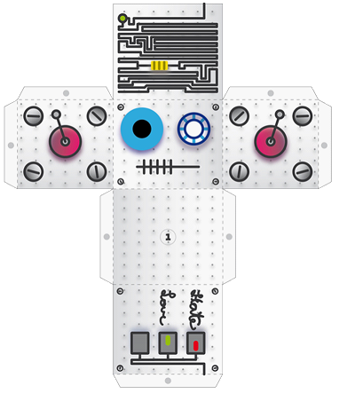
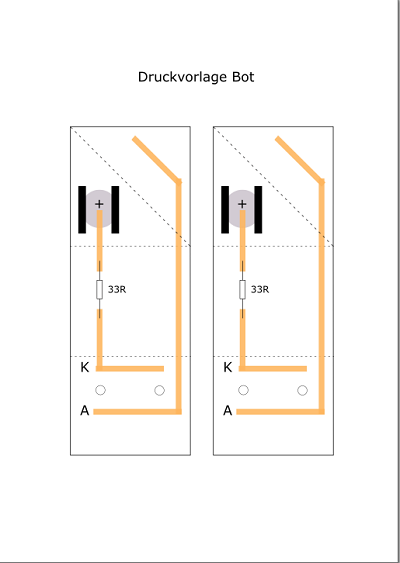
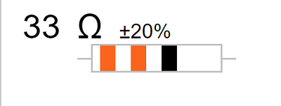
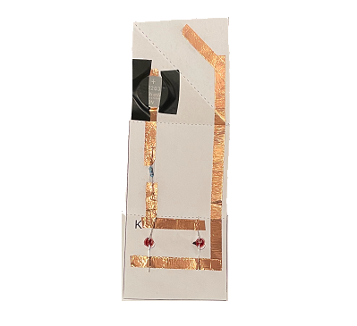
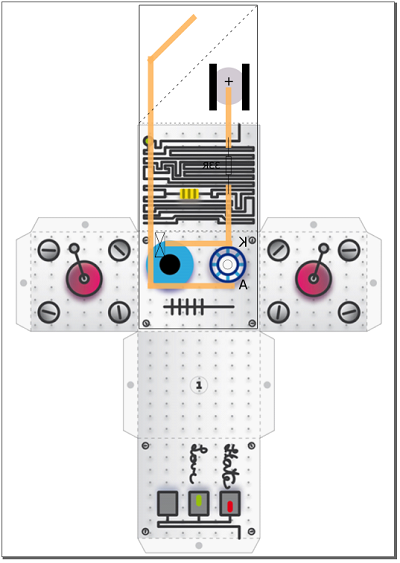
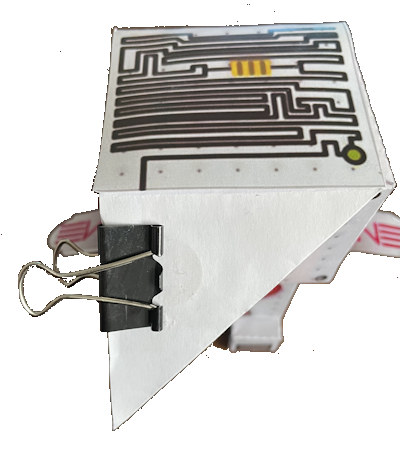
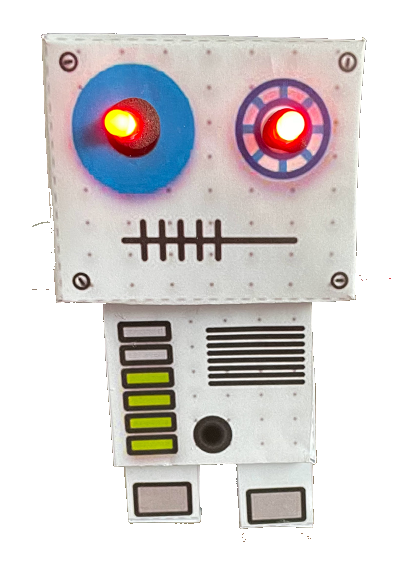

|[:skull:ISSUE](https://github.com/frankyhub/Paper-Circuit-BOT/issues?q=is%3Aissue)|[:speech_balloon: Forum /Discussion](https://github.com/frankyhub/Paper-Circuit-BOT/discussions)|[:grey_question:WiKi](https://github.com/frankyhub/Paper-Circuit-BOT/wiki)||
|--|--|--|--|
| | | | |
<a href="https://github.com/frankyhub/Paper-Circuit-BOT/issues">|<a href="https://github.com/frankyhub/Paper-Circuit-BOT/discussions">|<a href="https://github.com/frankyhub/Paper-Circuit-BOT/releases">||
|| <a href="https://github.com/frankyhub/Paper-Circuit-BOT/pulse" alt="Activity">| <a href="https://github.com/frankyhub/Paper-Circuit-BOT/graphs/traffic">  |<a href="https://github.com/frankyhub?tab=stars"> ||

# Paper-Circuit-BOT
Little BOT mit 2 LEDs

## Wir bauen einen Paper-Circuit-Bot mit 2 LEDs

 
   

## Die einzelnen Schritte:

+ Schneide den gesamten Grundkörper aus.

 
   

+ Schneide die Druckvorlage aus.

 
   

+ Stanze die Löcher für die 5mm LEDs aus.

+ Klebe die Kupferleiterbahnen auf die Vorlage, verbinde den 33R Widerstand und befestige die beiden LEDs. Das kurze Bein der LED zeigt nach oben zu K.

 
   

 
   

+ Befestige die Batterie mit zwei Klebestreifen. Der Plus-Pol zeigt nach oben.

 
   

+ Stanze die Löcher für die 5mm LEDs aus dem Grundkörper aus.

+ Klebe die Druckvorlage in die Innenseite des Grundkörpers

 
   

+ Knicke den oberen Teil der Druckvorlage diagonal ein und stelle mit der Klammer den Kontakt zur Batterie her, das ist unser Schalter.

 
   

+ Führe einen Funktionstest durch.

+ Falte den Grundkörper an den gestrichelten Linien und verklebe den Kopf an den Falzstellen.

+ Verklebe den Kopf, den Body und die Füße.

  ---

  
## BOM

| Stück | Bezeichnung |
| -------- | -------- | 
| 1        |   [Druckvorlage](/pdf/Bot-Druckvorlage.pdf)    |
| 1        |  [BOT-Vorlage](/pdf/MetalBot2.pdf)    |
| 1        | CR2032       | 
| 2        | LED 5mm rot        | 
| 1        | R 33       | 
| 1        | CU-Band       |
| 1        | Binder Clip 25mm       |
| 1        | Kleber     |

---

## Und fertig ist der kleine BOT 

 
   

---

   
<ol class="breadcrumb" style="border-top: 2px solid black;border-bottom:2px solid black; height: 45px; width: 900px;"> 
<a href="#oben">nach oben</a>
</ol>

---

